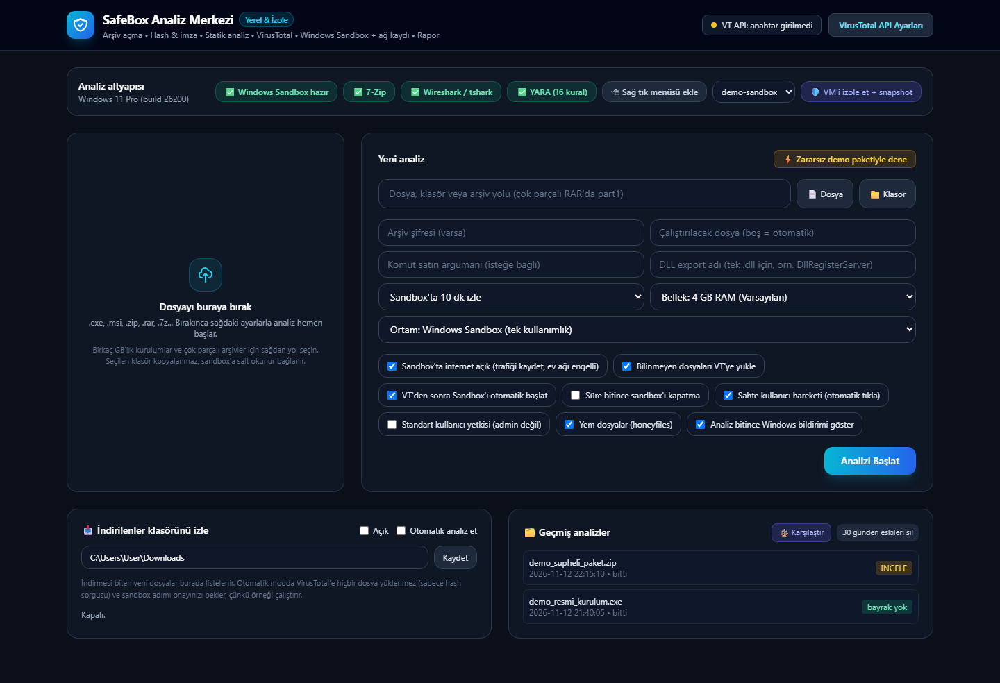
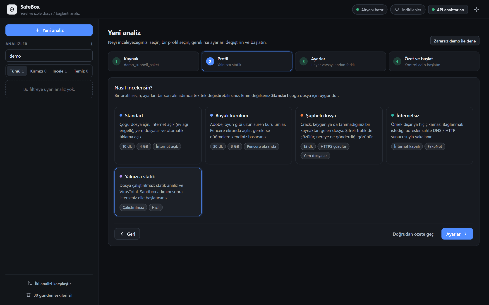
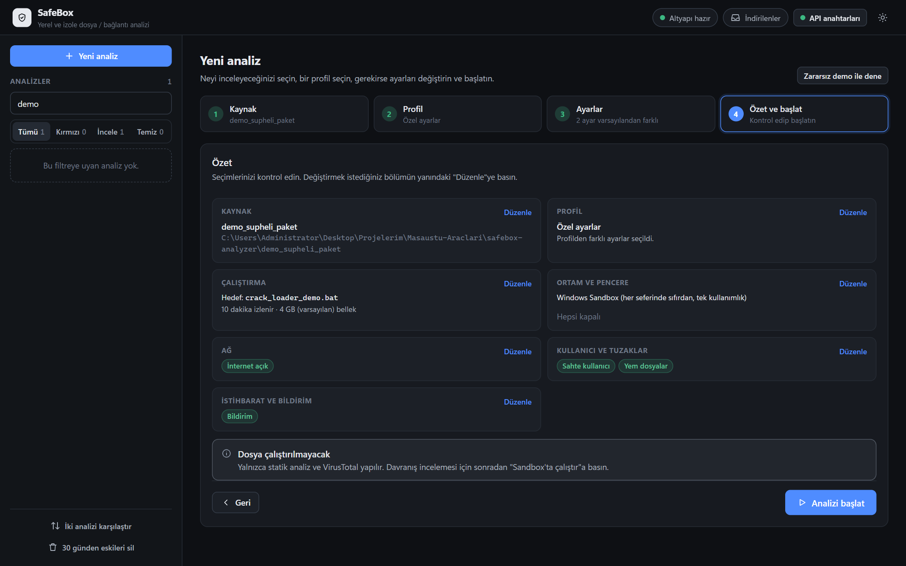
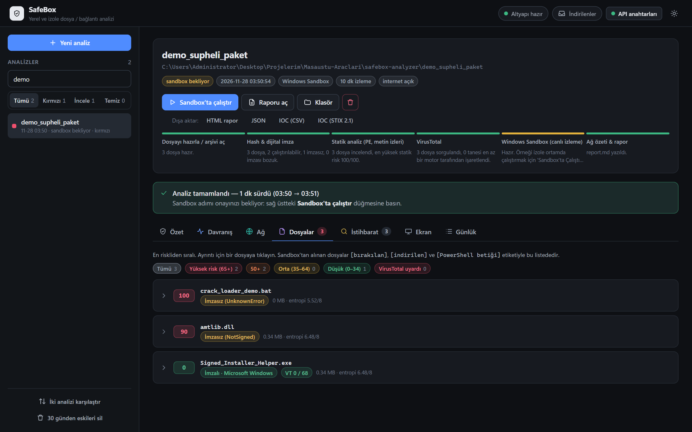

# SafeBox / wsb-triage

[](https://github.com/erkinavcii/wsb-triage/actions/workflows/tests.yml)

> **Automated Windows Sandbox Malware Analysis & Triage Pipeline**

[Türkçe dökümantasyon için buraya bakın (README.tr.md)](README.tr.md)

SafeBox is a lightweight, local web-based triage and malware analysis workbench for Windows. It provides end-to-end automated and interactive behavioral analysis using disposable Windows Sandbox environments, complete with network packet capture, process/registry tracing, static PE inspection, and VirusTotal enrichment.



<table>
  <tr>
    <td width="33%"></td>
    <td width="33%"></td>
    <td width="33%"></td>
  </tr>
  <tr>
    <td align="center"><sub>Step 2: ready-made profiles</sub></td>
    <td align="center"><sub>Step 4: review and warnings before starting</sub></td>
    <td align="center"><sub>Result: files filtered by risk</sub></td>
  </tr>
</table>

A new analysis is a four-step wizard: pick the source (file, folder, archive or link), pick a profile (Standard, Large installer, Suspicious file, Offline, Static only), adjust grouped settings if needed, then review and start. Results are split into paginated Summary, Behavior, Network, Files, Intel, Screen and Log tabs. *(The UI is in Turkish.)*

---

## Key Features

- **Isolated One-Click Windows Sandbox Analysis:**
  - Automated `.wsb` provisioning with strictly hardened configurations (vGPU, clipboard, audio, printer, and camera redirections disabled).
  - Samples and tools mapped strictly **Read-Only** (`C:\Analysis\input`, `C:\Analysis\tools`); only output is writable (`C:\Analysis\output`).
  - Configurable sandbox RAM allocation (2 GB up to 16 GB).
  - Automated LAN blocking firewall inside the sandbox: keeps internet access active for C2 observation while protecting local home/office subnets and host endpoints.
  - Optional **simulated user interaction** (gentle cursor movement and UI Automation clicks scoped strictly to the sample's process tree) to bypass idle evasion or advance installer prompts.
  - **Honeyfiles:** decoy browser profiles, wallet and document files; reading or encrypting them is a red finding.
  - **Offline mode with FakeNet:** internet off, a fake DNS / HTTP server inside the sandbox records every address the sample tries to reach.
  - Optional **standard-user run** to surface privilege-escalation attempts, and an optional **VirtualBox** backend (network isolation + clean snapshot from the UI) for samples that detect Windows Sandbox.
- **Link (URL) Analysis:**
  - A link is never opened on the host. Edge opens it inside the sandbox with its own profile (no SmartScreen or download prompts), with internet and HTTPS decryption on.
  - The redirect chain is recorded, a VirusTotal URL report is looked up (the address only), and every file it downloads is copied out encoded and analyzed on the host without being run. Edge starting a non-Edge program is a red finding.
- **HTTPS Decryption (optional):**
  - `mitmproxy` runs inside the sandbox with its CA trusted (system store plus `SSL_CERT_FILE` / `NODE_EXTRA_CA_CERTS`, QUIC blocked) and logs method, full URL, status, sizes and the first 1 KB sent. Data sent to abused services (Telegram, Discord webhooks, paste sites) is red.
- **Deep Live Behavioral Monitoring & Attribution:**
  - Background network packet capture (`pktmon` / `.pcapng`) with configurable per-packet snaplen/size cap.
  - **Periodic desktop screenshots** captured inside the sandbox, strictly validated (`PNG + IHDR` header check, non-symlink, size-capped) before rendering in the UI.
  - Process creation tree (`Win32_ProcessStartTrace`), command-line tracing, and suspicious parameter flags (hidden/encoded PowerShell, bypasses).
  - **Process-to-network attribution:** correlates `tshark`-extracted DNS answers, TLS SNI, and HTTP endpoints with in-sandbox socket/DNS state to identify which process initiated each connection.
  - Persistence inspection (Services, Device Drivers, Scheduled Tasks, Run/RunOnce keys, Startup folder, IFEO) and tamper detection (Defender, `hosts`, firewall).
  - **PowerShell script blocks (event 4104):** ScriptBlockLogging is enabled before the baseline; blocks from the sample's PowerShell processes are reassembled and analyzed as decoded code (`-EncodedCommand` / base64 layers arrive as plain text).
- **Dropped Files, Memory & Malware Family / C2 Config:**
  - Executables and scripts the sample drops (unsigned, suspicious locations first) are copied out XOR-encoded and get the same static analysis, signature, YARA and config extraction on the host, never run. A file the host antivirus removes is reported red.
  - **Memory dumps:** private and executable memory of the sample's processes (an early dump after 6 s, since stealers exit fast, and one at the end) is scanned with YARA in RAM and then deleted.
  - **Family and C2 config extraction** with [CAPE parsers](https://github.com/CAPESandbox/CAPE-parsers) (66 families) on the riskiest files and on carved PE images from the memory dumps. Runs in a separate process and environment; config addresses become C2 IOCs.
- **Capabilities & Hidden Strings (capa / FLOSS, optional):**
  - Mandiant's [capa](https://github.com/mandiant/capa) lists what the riskiest unsigned programs can do, and [FLOSS](https://github.com/mandiant/flare-floss) recovers the strings they only build at run time; both run next to the sandbox and never execute the file.
  - A capability alone is never red (notepad.exe has 30+). Only a few groups (injection, credential collection, keylogging, VM detection, persistence, C2) are carried into the verdict as notes; a capa malware-family rule or a C2 address hidden in FLOSS strings is red.
- **Verdict, Score & MITRE ATT&CK:**
  - Red / review / clean verdict with a **1–10 score** (10 = known malware, "incomplete" when a check did not run) and findings mapped to **ATT&CK techniques** with evidence.
  - **Combined rules** that need evidence of different kinds before they fire: credential access + data sent out, download + running an unsigned dropped program, autostart of a dropped program, a bare .NET tool (RegAsm, MSBuild...) started and then talking to the network, evasion ability + a sandbox run where nothing happened, an address the file hid being contacted, decoy files changed + recovery disabled.
  - **Process tree** of the sample in the panel and the report.
- **Multi-Source Threat Intel:**
  - Dropped executables are hashed inside the sandbox and looked up on VirusTotal without uploading them.
  - Optional **MalwareBazaar & Hybrid Analysis** hash-only enrichment (available automatically as a backup when VirusTotal has no key or hits quota, or per file on demand).
- **Static PE, Installer Unpacking & YARA Triage:**
  - Recursive archive decompression and safe **installer payload unpacking** (NSIS, MSI, CAB, SFX under size guards) to triage embedded binaries prior to execution.
  - **YARA scanning** (`rules/safebox_builtin.yar`) using `yara-python` (installed via `requirements.txt`); without it, a built-in fallback runs simple rules only and lists the ones it skips.
  - Authenticode digital signature validation (valid, broken/mismatched, or unsigned), PE header entropy analysis, section anomalies, anti-analysis API heuristics, and infostealer/C2 string matching.
- **Reporting, IOC Export & Run Comparison:**
  - Generates structured Markdown (`report.md`), clean standalone HTML (`report.html`), and machine-readable JSON (`state.json`).
  - One-click **IOC Export** in **CSV** (spreadsheet-safe) and **STIX 2.1 Bundle** formats (`/api/jobs/{case_id}/iocs`).
  - **Run Comparison (Diff):** side-by-side comparison between a baseline/official build and a suspect/cracked build (`/api/compare`), highlighting modified hashes, broken signatures, new YARA/static findings, persistence diffs, and extra external domains/IPs.
- **Workflow & Host Integration:**
  - Real-time **Download Folder Watcher** with baseline diffing, stable-size debouncing, and automated triage.
  - Optional **Windows Desktop Notification** upon job completion and **Explorer Right-Click Context Menu** (`HKCU`, reversible from the UI header) backed by `enqueue.py`.
- **Hardened Local Security:**
  - Bound strictly to `127.0.0.1`, DNS rebinding protection, CSRF prevention (`Sec-Fetch-Site` & `Origin`), strict Content-Security-Policy (`script-src 'self'; style-src 'self'`), and startup secret API token validation (`X-SafeBox-Token` / `HttpOnly` cookie) across all `/api/*` endpoints.

---

## Architecture Overview

```
                      +---------------------------------------+
                      |       SafeBox Host Web UI (8765)      |
                      |    FastAPI + Static CSS + Strict CSP  |
                      +-------------------+-------------------+
                                          |
                        +-----------------+-----------------+
                        |                                   |
              [Static & Intel Stage]             [Windows Sandbox Stage]
                        |                                   |
            - 7-Zip archive & installer       - Provision hardened .wsb (RAM config)
              unpack (NSIS/MSI/CAB/SFX)       - Map input/tools (read-only)
            - Authenticode & PE heuristics    - File: run sample, fake cursor / UIA
            - YARA rules (builtin/yara-py)    - Link: open URL in Edge, save downloads
            - CAPE family / C2 config         - pktmon, optional mitmproxy / FakeNet
            - VT / MalwareBazaar / HA hash    - PowerShell 4104, memory dumps, drops
                        |                                   |
                        +-----------------+-----------------+
                                          |
                   [Verdict 1-10 + ATT&CK, Report, IOCs & Diff Engine]
                       (Markdown, HTML, JSON, CSV & STIX 2.1)
```

---

## Prerequisites

1. **Windows 10 / 11 Pro, Enterprise, or Education** (with Windows Sandbox enabled).
   - *Can be enabled directly from the UI panel or via PowerShell:*
     ```powershell
     Enable-WindowsOptionalFeature -Online -FeatureName 'Containers-DisposableClientVM' -All
     ```
2. **Python 3.10+**
3. **7-Zip (25.01+)** installed for archive decompression: [7-zip.org](https://www.7-zip.org)
4. *(Recommended)* **Wireshark / tshark** for network capture dissection: [wireshark.org](https://www.wireshark.org)
5. *(Optional)* **Sysinternals Procmon64.exe** placed in `sandbox/` directory for full event logging.
6. *(Optional)* Tools kept outside the repository under `%LOCALAPPDATA%\SafeBox\` (without them the step is skipped and the panel says so):
   - `extractor-venv\` (a Python 3.13 venv with `CAPE-parsers`) and `cape-rules\` (CAPE family YARA rules, GPLv3) for family / C2 config extraction.
   - `mitmproxy\mitmdump.exe` for HTTPS decryption (SHA-256 pinned, only ever run inside the sandbox).
   - `flare\capa.exe` (capa v10.0.0) and `flare\floss.exe` (FLOSS v3.2.0), the standalone Windows builds from Mandiant's GitHub releases (SHA-256 pinned; they read files on the host, they never run them).

---

## Installation & Quick Start

1. Clone the repository:
   ```cmd
   git clone https://github.com/erkinavcii/wsb-triage.git
   cd wsb-triage
   ```

2. Install dependencies:
   ```cmd
   pip install -r requirements.txt
   ```

3. Launch SafeBox:
   - Double-click **`Baslat.bat`** (automatically handles the session token and opens the browser), or run:
     ```cmd
     python app.py
     ```
   - Open the printed authenticated URL (`http://127.0.0.1:8765/?token=...`) or paste the session token shown in console (`%LOCALAPPDATA%\SafeBox\session.token`) into the browser prompt.

---

## Running Automated Tests

SafeBox includes an automated unit and API test suite covering archive and installer unpacking, YARA scanning, VirusTotal/MalwareBazaar/Hybrid Analysis lookup and throttling, output quarantine & screenshot validation, IOC export (CSV/STIX 2.1), run comparison diffs, sandbox option/context-menu handling, and CSP/token security:

```cmd
pip install -r requirements-dev.txt
pytest
```

---

## Security Model & Guidelines

- **Untrusted Sandbox Output:** Files generated inside `cases/<case_id>/output/` during execution are treated as untrusted. Non-standard files are quarantined (`.quarantine` with `ZoneId=3`).
- **Privacy First:** Automatic watcher analyses never upload unknown binaries to VirusTotal; only SHA-256 hash lookups are performed.
- **Safety Disclaimer:** SafeBox assists in identifying malicious patterns and behaviors. A clean verdict significantly reduces risk but does not guarantee an executable is completely benign.

---

## License

MIT License. See [LICENSE](LICENSE) for details.
