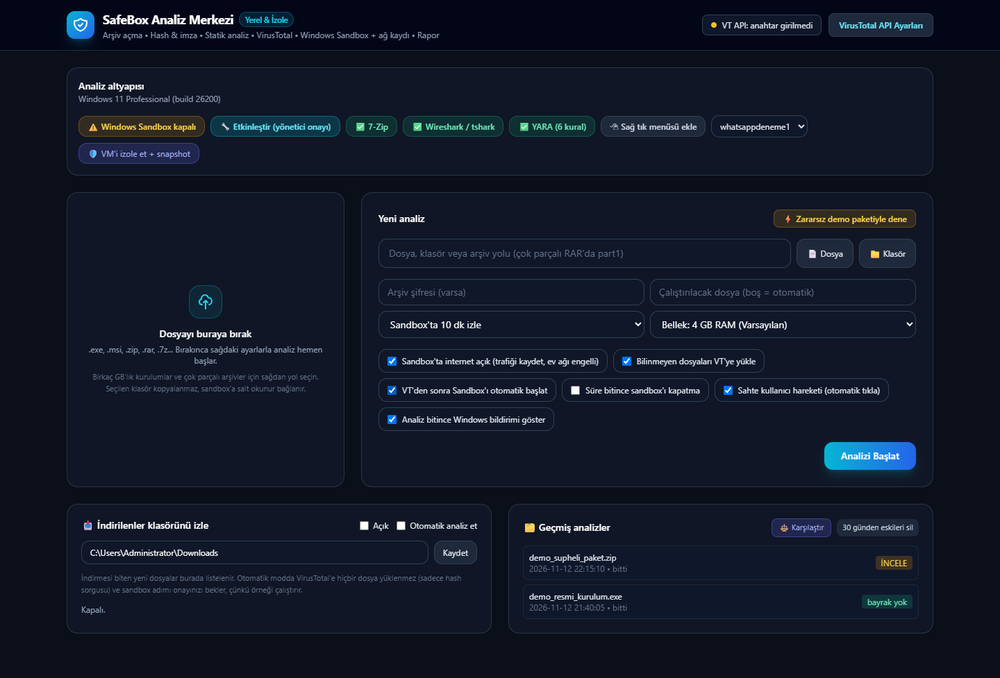

# SafeBox / wsb-triage

> **Automated Windows Sandbox Malware Analysis & Triage Pipeline**

[Türkçe dökümantasyon için buraya bakın (README.tr.md)](README.tr.md)

SafeBox is a lightweight, local web-based triage and malware analysis workbench for Windows. It provides end-to-end automated and interactive behavioral analysis using disposable Windows Sandbox environments, complete with network packet capture, process/registry tracing, static PE inspection, and VirusTotal enrichment.



---

## Key Features

- **Isolated One-Click Windows Sandbox Analysis:**
  - Automated `.wsb` provisioning with strictly hardened configurations (vGPU, clipboard, audio, printer, and camera redirections disabled).
  - Samples and tools mapped strictly **Read-Only** (`C:\Analysis\input`, `C:\Analysis\tools`); only output is writable (`C:\Analysis\output`).
  - Configurable sandbox RAM allocation (2 GB up to 16 GB).
  - Automated LAN blocking firewall inside the sandbox: keeps internet access active for C2 observation while protecting local home/office subnets and host endpoints.
  - Optional **simulated user interaction** (gentle cursor movement and UI Automation clicks scoped strictly to the sample's process tree) to bypass idle evasion or advance installer prompts.
- **Deep Live Behavioral Monitoring & Attribution:**
  - Background network packet capture (`pktmon` / `.pcapng`) with configurable per-packet snaplen/size cap.
  - **Periodic desktop screenshots** captured inside the sandbox, strictly validated (`PNG + IHDR` header check, non-symlink, size-capped) before rendering in the UI.
  - Process creation tree (`Win32_ProcessStartTrace`), command-line tracing, and suspicious parameter flags (hidden/encoded PowerShell, bypasses).
  - **Process-to-network attribution:** correlates `tshark`-extracted DNS answers, TLS SNI, and HTTP endpoints with in-sandbox socket/DNS state to identify which process initiated each connection.
  - Persistence inspection (Services, Device Drivers, Scheduled Tasks, Run/RunOnce keys, Startup folder, IFEO) and tamper detection (Defender, `hosts`, firewall).
- **Secondary Dropper & Multi-Source Threat Intel:**
  - Automatically indexes newly dropped executables inside the sandbox, calculates their SHA-256 hashes, and queries VirusTotal without uploading the files outside.
  - Optional **MalwareBazaar & Hybrid Analysis** hash-only enrichment (available automatically as a backup when VirusTotal has no key or hits quota, or per file on demand).
- **Static PE, Installer Unpacking & YARA Triage:**
  - Recursive archive decompression and safe **installer payload unpacking** (NSIS, MSI, CAB, SFX under size guards) to triage embedded binaries prior to execution.
  - **YARA scanning** (`rules/safebox_builtin.yar`) using `yara-python` when available or an offline built-in rule scanner fallback.
  - Authenticode digital signature validation (valid, broken/mismatched, or unsigned), PE header entropy analysis, section anomalies, anti-analysis API heuristics, and infostealer/C2 string matching.
- **Reporting, IOC Export & Run Comparison:**
  - Generates structured Markdown (`report.md`), clean standalone HTML (`report.html`), and machine-readable JSON (`state.json`).
  - One-click **IOC Export** in **CSV** (spreadsheet-safe) and **STIX 2.1 Bundle** formats (`/api/jobs/{case_id}/iocs`).
  - **Run Comparison (Diff):** side-by-side comparison between a baseline/official build and a suspect/cracked build (`/api/compare`), highlighting modified hashes, broken signatures, new YARA/static findings, persistence diffs, and extra external domains/IPs.
- **Workflow & Host Integration:**
  - Real-time **Download Folder Watcher** with baseline diffing, stable-size debouncing, and automated triage.
  - Optional **Windows Desktop Notification** upon job completion and **Explorer Right-Click Context Menu** (`HKCU`, reversible from the UI header) backed by `enqueue.py`.
- **Hardened Local Security:**
  - Bound strictly to `127.0.0.1`, DNS rebinding protection, CSRF prevention (`Sec-Fetch-Site` & `Origin`), strict Content-Security-Policy (`script-src 'self'; style-src 'self'`), and startup secret API token validation (`X-SafeBox-Token` / `HttpOnly` cookie) across all `/api/*` endpoints.

---

## Architecture Overview

```
                      +---------------------------------------+
                      |       SafeBox Host Web UI (8765)      |
                      |    FastAPI + Static CSS + Strict CSP  |
                      +-------------------+-------------------+
                                          |
                        +-----------------+-----------------+
                        |                                   |
              [Static & Intel Stage]             [Windows Sandbox Stage]
                        |                                   |
            - 7-Zip archive & installer       - Provision hardened .wsb (RAM config)
              unpack (NSIS/MSI/CAB/SFX)       - Map input/tools (read-only)
            - Authenticode & PE heuristics    - Optional fake cursor / UIA clicks
            - YARA rules (builtin/yara-py)    - Periodic screen capture + pktmon
            - VT / MalwareBazaar / HA hash    - Process/net correlation & drop diff
                        |                                   |
                        +-----------------+-----------------+
                                          |
                            [Report, IOCs & Diff Engine]
                       (Markdown, HTML, JSON, CSV & STIX 2.1)
```

---

## Prerequisites

1. **Windows 10 / 11 Pro, Enterprise, or Education** (with Windows Sandbox enabled).
   - *Can be enabled directly from the UI panel or via PowerShell:*
     ```powershell
     Enable-WindowsOptionalFeature -Online -FeatureName 'Containers-DisposableClientVM' -All
     ```
2. **Python 3.10+**
3. **7-Zip (25.01+)** installed for archive decompression: [7-zip.org](https://www.7-zip.org)
4. *(Recommended)* **Wireshark / tshark** for network capture dissection: [wireshark.org](https://www.wireshark.org)
5. *(Optional)* **Sysinternals Procmon64.exe** placed in `sandbox/` directory for full event logging.

---

## Installation & Quick Start

1. Clone the repository:
   ```cmd
   git clone https://github.com/erkinavcii/wsb-triage.git
   cd wsb-triage
   ```

2. Install dependencies:
   ```cmd
   pip install -r requirements.txt
   ```

3. Launch SafeBox:
   - Double-click **`Baslat.bat`** (automatically handles the session token and opens the browser), or run:
     ```cmd
     python app.py
     ```
   - Open the printed authenticated URL (`http://127.0.0.1:8765/?token=...`) or paste the session token shown in console (`%LOCALAPPDATA%\SafeBox\session.token`) into the browser prompt.

---

## Running Automated Tests

SafeBox includes an automated unit and API test suite covering archive and installer unpacking, YARA scanning, VirusTotal/MalwareBazaar/Hybrid Analysis lookup and throttling, output quarantine & screenshot validation, IOC export (CSV/STIX 2.1), run comparison diffs, sandbox option/context-menu handling, and CSP/token security:

```cmd
pip install -r requirements-dev.txt
pytest
```

---

## Security Model & Guidelines

- **Untrusted Sandbox Output:** Files generated inside `cases/<case_id>/output/` during execution are treated as untrusted. Non-standard files are quarantined (`.quarantine` with `ZoneId=3`).
- **Privacy First:** Automatic watcher analyses never upload unknown binaries to VirusTotal; only SHA-256 hash lookups are performed.
- **Safety Disclaimer:** SafeBox assists in identifying malicious patterns and behaviors. A clean verdict significantly reduces risk but does not guarantee an executable is completely benign.

---

## License

MIT License. See [LICENSE](LICENSE) for details.
