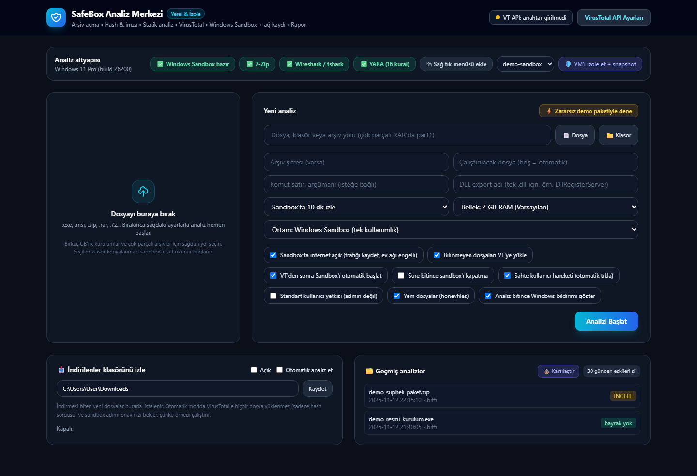
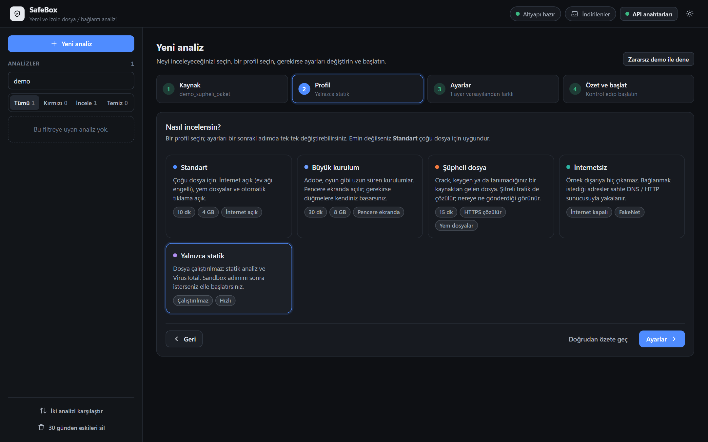
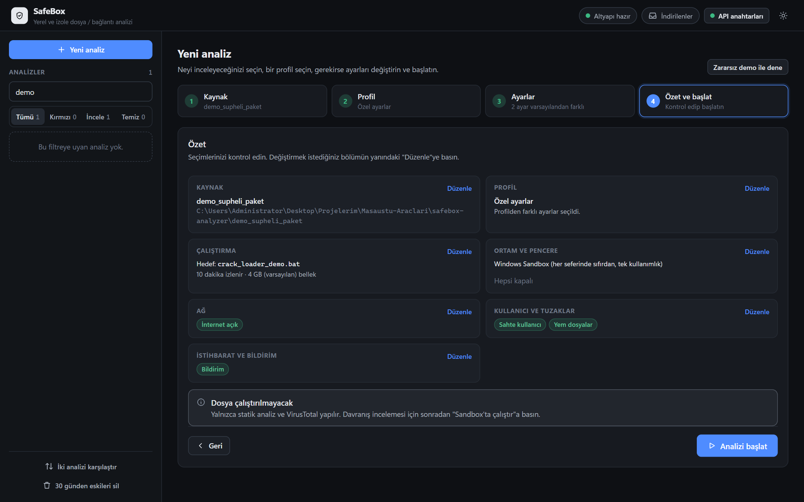
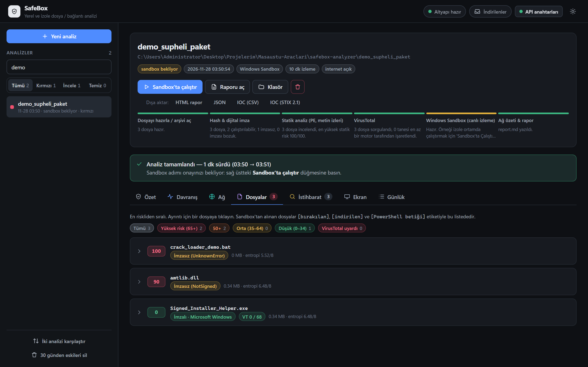

# SafeBox Analiz Merkezi

[](https://github.com/erkinavcii/wsb-triage/actions/workflows/tests.yml)

> [English documentation (README.md)](README.md)

İndirdiğin bir dosyayı kendi bilgisayarında çalıştırmadan önce otomatik ve yerel olarak inceleyen web tabanlı analiz ve triyaj paneli.



<table>
  <tr>
    <td width="33%"></td>
    <td width="33%"></td>
    <td width="33%"></td>
  </tr>
  <tr>
    <td align="center"><sub>Adım 2: hazır profiller</sub></td>
    <td align="center"><sub>Adım 4: başlatmadan önce özet ve uyarılar</sub></td>
    <td align="center"><sub>Sonuç: riske göre süzülen dosyalar</sub></td>
  </tr>
</table>

**Başlatmak için `Baslat.bat`'a çift tıkla:** sunucu `http://127.0.0.1:8765` adresinde açılır, `%LOCALAPPDATA%\SafeBox\session.token` içindeki oturum belirteciyle tarayıcıda otomatik oturum açar. **Yeni analiz** dört adımda ilerler: kaynağı seç (dosya, klasör, arşiv ya da bağlantı), bir profil seç (Standart, Büyük kurulum, Şüpheli dosya, İnternetsiz, Yalnızca statik), gerekirse ayarları gruplar halinde değiştir ve özeti kontrol edip başlat. Sonuçlar Özet, Davranış, Ağ, Dosyalar, İstihbarat, Ekran ve Günlük sekmelerinde, sayfalanmış olarak gösterilir. Arka planda şu adımlar çalışır:

| # | Adım | Ne yapar |
|---|---|---|
| 1 | Hazırla & Paket Aç | Arşivi 7-Zip ile açar (RAR, şifreli, çok parçalı `.part1`/`.001`), boyut/bomba kontrolü yapar. **NSIS, MSI, CAB ve SFX** kurulum paketlerinin içindeki dosyaları da `unpacked\` altına çıkarıp (`[paket içi]`) ön taramaya ekler. Seçtiğin **klasör kopyalanmaz**, sandbox'a salt okunur bağlanır; İndirilenler/Masaüstü gibi geniş klasörler reddedilir. **Host'ta hiçbir şey çalıştırılmaz.** |
| 2 | Hash, İmza & Statik + YARA Analizi | Tüm dosyaların SHA-256 özetini ve Authenticode dijital imzalarını doğrular (Defender tarafından karantinaya alınan dosyalar dahil). En şüpheli dosyalarda PE entropi, riskli API birleşimleri, stealer/C2 dizge izleri ve `rules\safebox_builtin.yar` (`yara-python` ile; kurulu değilse sadece basit kuralları çalıştıran yerleşik ayrıştırıcı) ile **YARA** taraması yapar. |
| 3 | Çok Kaynaklı Tehdit İstihbaratı | **VirusTotal**'de önce tüm dosyaları hash ile sorgular, ardından istenirse bilinmeyenleri (650 MB'a kadar) yükler ve ücretsiz API kotasına göre kendisi bekler. VT anahtarı yokken veya kota dolduğunda yedek olarak **MalwareBazaar** ve **Hybrid Analysis** üzerinden yalnızca hash sorgusu yapar (dosya kartından elle de sorulabilir). |
| 4 | Windows Sandbox (Canlı İzleme) | Örneği izole, tek kullanımlık Windows'ta çalıştırır (`2 GB–16 GB` RAM ve `1–180 dk` süre seçilebilir). Yeni işlemler (`Win32_ProcessStartTrace`), TCP bağlantıları, servisler, sürücüler, zamanlanmış görevler, başlangıç/Run/IFEO kayıtları, Defender, `hosts` ve güvenlik duvarı değişikliklerini izler. `pktmon --pkt-size 4096` ile `capture.pcapng` ağ kaydı tutar. Örneğin bıraktığı çalıştırılabilir dosya ve betikleri, çalıştırdığı **PowerShell kod bloklarını (event 4104, base64 katmanları çözülmüş)** ve **bellek dökümlerini** dışarı alır; bunlar host'ta çalıştırılmadan incelenir. İsteğe bağlı olarak **30 saniyede bir ekran görüntüsü** alır ve **sahte kullanıcı hareketi** (yalnızca örnek işlem ağacındaki kurulum pencerelerine tıklama) uygular. |
| 5 | Ağ Korelasyonu & Raporlama | Wireshark (`tshark`) kuruluysa DNS yanıtları, TLS SNI ve HTTP trafiğini Sandbox `Connections`/`DnsCache` kayıtlarıyla eşleştirerek hangi işlemin hangi adrese bağlandığını gösterir. Sonucu **KIRMIZI / İNCELE / bayrak yok** kararı, **1–10 puan** ve **MITRE ATT&CK** teknik etiketleriyle verir; `report.md`, bağımsız `report.html`, `state.json` üretir ve **CSV / STIX 2.1 IOC** dışa aktarımı sunar. |

---

## Öne Çıkan Özellikler

- **Bağlantı (URL) Analizi:** Bağlantı host'ta hiç açılmaz. Sandbox içinde Edge kendi profiliyle açar (SmartScreen ve indirme sorusu kapalı); yönlendirme zinciri kaydedilir, adres VirusTotal'de sorulur (yalnızca adres gönderilir) ve indirilen her dosya şifrelenerek dışarı alınıp çalıştırılmadan incelenir. Edge'in kendisi dışında bir program başlatması kırmızı bulgudur.
- **Zararlı Ailesi & C2 Ayarı Çıkarma:** [CAPE-parsers](https://github.com/CAPESandbox/CAPE-parsers) (66 aile) en riskli dosyalarda ve bellek dökümlerinden kesilen PE görüntülerinde ayrı bir süreç ve ortamda çalışır; bulunan C2 adresleri karara, rapora ve IOC dışa aktarımına girer.
- **Yetenek ve Gizli Metin (capa / FLOSS, isteğe bağlı):** Mandiant'ın [capa](https://github.com/mandiant/capa) aracı en riskli imzasız programların neler yapabildiğini, [FLOSS](https://github.com/mandiant/flare-floss) ise yalnızca çalışırken oluşturdukları gizli metinleri çıkarır; ikisi de sandbox'la eş zamanlı çalışır ve dosyayı çalıştırmaz. Tek bir yetenek asla kırmızı sayılmaz (notepad.exe'de bile 30'dan fazla çıkar); yalnızca enjeksiyon, kimlik verisi toplama, tuş kaydı, sanal makine tespiti, kalıcılık ve C2 grupları not olarak karara girer. capa'nın zararlı ailesi kuralı ya da FLOSS metinlerinde gizlenmiş bir C2 adresi kırmızıdır.
- **Birleşik Kurallar ve Süreç Ağacı:** Farklı türde kanıtlar birlikte görülünce devreye giren kurallar: kimlik verisine erişim + dışarı veri gönderme, indirip bıraktığı imzasız programı çalıştırma, bıraktığı programı otomatik başlatmaya ekleme, argümansız başlatılan .NET aracının (RegAsm, MSBuild...) ağa bağlanması, sanal makine tespit yeteneği + sandbox'ta hiçbir şey olmaması, dosyanın gizlediği adrese bağlanılması, yem dosyaların değişmesi + kurtarmanın kapatılması. Örneğin süreç ağacı panelde ve raporda gösterilir.
- **Bellek Taraması:** Örneğin işlemlerinin bellek dökümü 6. saniyede (hızlı kapanan stealer'lar için) ve sonda alınır, YARA ile yalnızca RAM'de taranır ve silinir.
- **HTTPS Trafiğini Çözme (isteğe bağlı):** Sandbox içinde `mitmproxy` çalışır; istek yöntemi, tam adres, durum kodu, boyut ve gönderilen verinin ilk 1 KB'ı kaydedilir. Telegram, Discord webhook, paste siteleri gibi kötüye kullanılan servislere veri gitmesi kırmızı bulgudur.
- **İnternetsiz Mod & Yem Dosyalar:** İnternet kapalıyken sandbox içindeki sahte DNS / HTTP sunucusu (FakeNet) örneğin bağlanmak istediği adresleri yakalar. Sahte tarayıcı, cüzdan ve belge dosyaları okunur ya da şifrelenirse kırmızı bulgu olur.
- **VirtualBox Desteği:** Windows Sandbox'ı tanıyan örnekler için VirtualBox sanal makinesi kullanılabilir; panelden ağı kapatıp temiz snapshot alınır.
- **İki Analizi Karşılaştır (Resmi vs Crack):** Geçmiş analizler içindeki iki sonucu yan yana kıyaslar; değişen dosya hash'lerini, bozulan dijital imzaları, YARA/statik risk artışlarını, yeni kalıcılık kayıtlarını ve ek dış alan adı/IP bağlantılarını raporlar.
- **İndirilenler Klasörü İzleyici:** İndirmesi biten yeni dosyaları algılar; otomatik modda VirusTotal'e dosya yüklemez (yalnızca hash sorar) ve örneği çalıştıracağı için Sandbox adımında onayını bekler.
- **Dosya Gezgini Sağ Tık Menüsü:** Panel üst barından tek tıkla yönetici yetkisi gerekmeden (`HKCU`) dosya ve klasörlere *"SafeBox ile analiz et"* bağlam menüsü eklenip kaldırılabilir (`enqueue.py`).
- **Windows Masaüstü Bildirimi:** Analiz tamamlandığında veya kırmızı bayrak oluştuğunda isteğe bağlı masaüstü bildirimi gönderir.
- **Çevrimdışı Yerel Arayüz & Güçlendirilmiş Güvenlik:** Dış CDN bağlantısı içermez (`static\styles.css`), sıkı CSP (`script-src 'self'; style-src 'self'`), CSRF/DNS-rebinding koruması ve rastgele oturum belirteci (`X-SafeBox-Token` + `HttpOnly; SameSite=Strict` çerez) kullanır.

---

## Tek Seferlik Kurulum

1. **Windows Sandbox:** Paneldeki *"Etkinleştir (yönetici onayı)"* butonuna basıp bilgisayarı yeniden başlatın (veya yönetici PowerShell'de `Enable-WindowsOptionalFeature -Online -FeatureName Containers-DisposableClientVM -All`).
2. **Python 3.10+ & Bağımlılıklar:** `pip install -r requirements.txt`
3. **7-Zip 25.01+** (RAR/şifreli arşiv ve paket açma için gerekli): https://www.7-zip.org
4. **Wireshark / tshark** *(önerilir, ağ özeti ve korelasyon için)*: https://www.wireshark.org (Sandbox içi yakalama `pktmon` kullandığı için Npcap kurulumu gerekmez).
5. **Tehdit İstihbaratı API Anahtarları:** Paneldeki *"API anahtarları"* penceresinden VirusTotal (ve isteğe bağlı olarak MalwareBazaar Auth-Key / Hybrid Analysis anahtarı) girilebilir; anahtarlar yerelde `config.json` veya ortam değişkenlerinde saklanır.
6. *(İsteğe bağlı)* Sysinternals `Procmon64.exe` aracını `sandbox\` klasörüne koyarsanız sandbox içinde `procmon.pml` kaydı da alınır. `rules\` klasörüne kendi `.yar` dosyalarınızı ekleyebilirsiniz.
7. *(İsteğe bağlı)* Repo dışında, `%LOCALAPPDATA%\SafeBox\` altında duran araçlar (yoksa ilgili adım atlanır ve panel bunu söyler):
   - `extractor-venv\` (`CAPE-parsers` kurulu Python 3.13 ortamı) ve `cape-rules\` (CAPE aile YARA kuralları, GPLv3): zararlı ailesi / C2 ayarı çıkarma için.
   - `mitmproxy\mitmdump.exe`: HTTPS çözme için (SHA-256 ile sabitlenmiş, yalnızca sandbox içinde çalışır).
   - `flare\capa.exe` (capa v10.0.0) ve `flare\floss.exe` (FLOSS v3.2.0): Mandiant'ın GitHub sürümlerindeki tek dosyalık Windows yapıları (SHA-256 ile sabitlenmiş; ana bilgisayarda dosyayı yalnızca okurlar, çalıştırmazlar).

---

## Otomatik Testler

Depoda arşiv/kurulum açma, YARA taraması, VT/MalwareBazaar/Hybrid Analysis istemcileri, çıktı karantina ve ekran görüntüsü doğrulama, IOC dışa aktarım (CSV/STIX 2.1), karşılaştırma, sağ tık menüsü ve API/CSP güvenliğini kapsayan test paketi bulunur:

```cmd
pip install -r requirements-dev.txt
pytest
```

---

## Dosyalar

| Dosya / Klasör | İçerik |
|---|---|
| `app.py` | FastAPI web sunucusu (yalnızca `127.0.0.1`, API belirteci, sıkı CSP ve CSRF koruması) |
| `pipeline.py` | Çok aşamalı analiz hattı, kurulum açma, IOC dışa aktarım, karşılaştırma, rapor/HTML üretimi, izleyici |
| `analyzer.py` | Statik PE, dijital imza, string ve YARA entegrasyonu |
| `yara_scanner.py` | `yara-python` + yerleşik offline YARA ayrıştırıcı motoru |
| `vt_client.py` | VirusTotal API istemcisi (kota yönetimi, akışlı büyük dosya yükleme) |
| `intel_client.py` | MalwareBazaar & Hybrid Analysis salt hash sorgu istemcisi |
| `flare_tools.py` | capa (yetenekler) ve FLOSS (gizlenmiş metinler) çalıştırıcısı; hash sabitleme, süre sınırı, çıktı ayrıştırma |
| `config_extractor.py` | CAPE-parsers ile zararlı ailesi / C2 ayarı çıkarma (ayrı Python ortamında, ayrı süreç olarak çalışır) |
| `sandbox_manager.py` | Sertleştirilmiş `.wsb` üretimi, Sandbox yaşam döngüsü, VirtualBox izolasyonu, `HKCU` sağ tık menüsü |
| `enqueue.py` | Sağ tık menüsünden hızlı analiz başlatıcı |
| `rules\safebox_builtin.yar` | Yerleşik YARA tespit kuralları |
| `sandbox\Inside-Sandbox.ps1` | Sandbox içinde çalışan izleyici (`pktmon`, `Invoke-FakeUser`, `Capture-Screen`, işlem/bağlantı farkı) |
| `static\` | Çevrimdışı derlenmiş `styles.css`, `app.js`, `auth.js`, `index.html`, `auth.html` |
| `tests\` | Birim, statik, güvenlik ve API test paketi |
| `cases\<tarih>_<ad>\` | Her analiz: `input\`, `unpacked\`, `output\` (`capture.pcapng`, `screenshots\`, `behavior.json`, `timeline.log`), `report.md`, `report.html`, `state.json` |

---

## Güvenlik Notları

- **Sandbox izolasyonu:** Örnek ve araçlar **salt okunur** paylaşılır; yalnızca `output\` yazılabilir. Pano, vGPU, yazıcı, mikrofon ve kamera kapalıdır.
- **`cases\...\output\` içindeki hiçbir şeyi çalıştırmayın.** Sandbox içindeki zararlı bu klasöre yazabilir. Analiz bitince izleyicinin dosyaları ve `PNG+IHDR` başlığı doğrulanan `scr_NNN.png` kareleri dışındaki her dosya `.quarantine` uzantısı + `ZoneId=3` ile işaretlenir ve **KIRMIZI** bayrak verilir.
- **Anti-analiz & sahte veri koruması:** İzleyici `live.json` dosyası 3 dakika güncellenmezse **KIRMIZI** bayrak verilir. Sandbox JSON çıktıları `sanitize_sandbox_json` ve tür/biçim kontrollerinden geçirilir.
- **Büyük salt okunur kurulumlar:** 1 GB üstü kurulumlar kendi klasörüne yazmak istediğinde salt okunur paylaşım nedeniyle başarısız olabilir; bu durumda raporda not/uyarı gösterilir (`in-place` uyarısı).
- **Yerel ağ engelleme:** İnternet açıkken sandbox içindeki güvenlik duvarı ev ağını (`10.x`, `172.16-31.x`, `192.168.x`, `169.254.x`, `100.64.x`, `fc00::/7`) ve ana bilgisayarı engeller; yalnızca sandbox'ın kendi ağ geçidi ve DNS'i açık kalır. Örnek yönetici haklarıyla bu kuralı silerse 5 saniye içinde yeniden uygulanır ve **KIRMIZI** bayrak verilir (aradaki kısa teorik boşluğu tamamen önlemek için *"Sandbox'ta internet açık"* kutusunu kapatabilirsiniz; bu durumda trafik kaydedilmez).
- **Gizlilik ve sınırlar:** İzleyici modunda, VT yedek sorgularında ve YARA/statik taramalarda bilinmeyen dosyalar dışarı yüklenmez, yalnızca SHA-256 hash sorulur. Geçerli dijital imza risk puanını düşürmez. Hiçbir statik veya süreli sandbox analizi mutlak temizlik garantisi vermez; yalnızca riski görünür kılar.

## Lisans

MIT — bkz. [LICENSE](LICENSE). Bu araç şüpheli dosyaları incelemek içindir; analiz ettiğin yazılımların lisans ve yasal sorumluluğu sana aittir.
