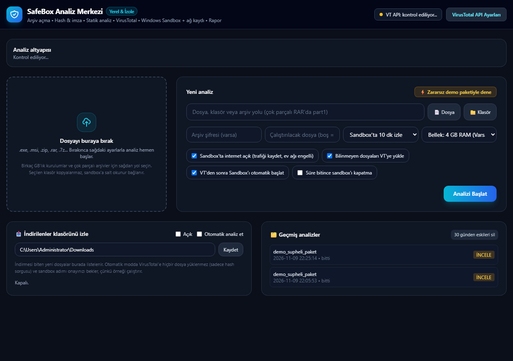

# SafeBox Analiz Merkezi

İndirdiğin bir dosyayı bilgisayarında çalıştırmadan önce otomatik olarak inceleyen yerel panel.

`Baslat.bat`'a çift tıkla, tarayıcıda **http://127.0.0.1:8765** açılır. Dosyayı panele bırak (ya da yolunu seç) ve **Analizi Başlat**'a bas. Gerisi sırayla kendiliğinden ilerler:

| # | Adım | Ne yapar |
|---|---|---|
| 1 | Hazırla | Arşivi 7-Zip ile açar (RAR, şifreli, çok parçalı), tek dosyayı kopyalar. Seçtiğin **klasör kopyalanmaz**, sandbox'a salt okunur bağlanır. İndirilenler, Masaüstü gibi geniş klasörler reddedilir. **Hiçbir şey çalıştırılmaz.** |
| 2 | Hash & imza | Tüm dosyaların SHA-256'sı, dijital imza kontrolü. Defender'ın sildiği dosyaları da yakalar. |
| 3 | Statik analiz | En şüpheli 40 dosyada PE başlıkları, entropi, şüpheli API'ler, stealer/Telegram/Discord/anti-VM izleri |
| 4 | VirusTotal | Önce tüm dosyaları hash ile sorgular (bilinen zararlılar hemen görünür), sonra bilinmeyenleri yükler (650 MB'a kadar), en sonda taramaları birlikte bekler. Ücretsiz kotaya göre kendisi bekler. |
| 5 | Windows Sandbox | Örneği izole, tek kullanımlık Windows'ta çalıştırır ve süre boyunca canlı izler: yeni işlemler, bağlantılar, servisler, görevler, başlangıç kayıtları, Defender ayarları, hosts, güvenlik duvarı, bırakılan dosyalar. Ağ trafiği `capture.pcapng` olarak kaydedilir. 1 GB'tan büyük kurulumlar sandbox diskine kopyalanmadan yerinde çalıştırılır. Kurulum dosyası otomatik seçilir: `Set-up.exe`/`setup`/`install` önce gelir, sonra `patch`/`crack`; `vc_redist`, `uninstall` gibi dosyalar sona atılır. Süre dolunca sandbox kapanır ve silinir. |
| 6 | Rapor | Wireshark kuruluysa trafiği özetler (DNS, TLS, HTTP; bilinmeyen alan adları kırmızı). Sonucu **KIRMIZI / İNCELE** olarak sınıflar, `report.md` yazar. |

**İndirilenler izleme:** Paneldeki "İndirilenler klasörünü izle" açıksa, indirmesi biten yeni dosyalar listede görünür. "Otomatik analiz et" seçiliyse 1-4. adımlar kendiliğinden çalışır. Sandbox adımı ise senin onayını bekler, çünkü örneği çalıştırır.

## Tek seferlik kurulum

1. **Windows Sandbox:** Paneldeki "Etkinleştir" butonuna bas, yönetici onayı ver ve bilgisayarı yeniden başlat.
2. **7-Zip 25.01+** (RAR/7z için gerekli): https://www.7-zip.org
3. **Wireshark** (otomatik ağ özeti ve kaydı açmak için): https://www.wireshark.org
4. **VirusTotal API anahtarı:** Paneldeki "VirusTotal API Ayarları" (ücretsiz). Anahtar `config.json`'da ya da `VT_API_KEY` ortam değişkeninde durabilir.
5. *(İsteğe bağlı)* Sysinternals `Procmon64.exe`'yi `sandbox\` klasörüne koyarsan sandbox içinde tüm dosya ve kayıt defteri olayları da `procmon.pml` olarak kaydedilir.

Python 3.10+ ve paketler: `pip install -r requirements.txt`

## Dosyalar

| Dosya | İçerik |
|---|---|
| `app.py` | Web sunucusu (sadece 127.0.0.1; başka sitelerden gelen istekleri reddeder) |
| `pipeline.py` | 6 adımlık otomatik analiz, İndirilenler izleyicisi, sonuç değerlendirmesi, rapor |
| `analyzer.py` | Statik PE / metin analizi |
| `vt_client.py` | VirusTotal API (kota beklemesi, büyük dosya yükleme) |
| `sandbox_manager.py` | Sertleştirilmiş `.wsb`, sandbox başlat/durdur, VirtualBox izolasyonu |
| `sandbox\Inside-Sandbox.ps1` | Sandbox içinde çalışan izleyici |
| `cases\<tarih>_<ad>\` | Her analiz: `input\` (örnek), `output\` (`capture.pcapng`, `behavior.json`, `timeline.log`), `report.md` |

## Güvenlik notları

- Sandbox ayarları: örnek ve araçlar **salt okunur** paylaşılır, sadece `output\` yazılabilir. Pano, vGPU, yazıcı, mikrofon ve kamera kapalıdır.
- **`cases\...\output\` içindeki hiçbir şeyi çalıştırma.** Sandbox içindeki zararlı bu klasöre yazabilir. Analiz bitince izleyicinin kendi dosyaları dışındaki her şey `.quarantine` uzantısı ve "internetten indirildi" işaretiyle (ZoneId=3) etiketlenir, ayrıca **KIRMIZI** bayrak verilir.
- Örnek, izleyici scripti öldürürse bu fark edilir: izleme sırasında `live.json` 3 dakika güncellenmezse **KIRMIZI** (anti-analiz) bayrak verilir ve o ana kadar toplanan veriler saklanır. Sandbox'tan gelen her veri yine de güvenilmezdir; akıllı bir zararlı sahte sonuç da yazabilir.
- Geçerli dijital imza risk puanını düşürmez. Zararlılar çalıntı sertifikalarla da imzalanır.
- Panele bırakılan dosyalar için sınır 4 GB, ayrıca diskte en az 2 GB boş alan kalmalı. Daha büyük dosyaları yol seçerek analiz et.
- Windows Sandbox bir bilgisayarda aynı anda bir kez açılabilir. İkinci analiz "sırada" bekler, ilki bitince kendiliğinden başlar.
- İnternet açıkken sandbox içinde bir güvenlik duvarı kuralı ev ağını (10.x, 172.16-31.x, 192.168.x, 169.254.x, 100.64.x, fc00::/7) ve ana bilgisayarı engeller. Sadece sandbox'ın kendi ağ geçidi ve DNS'i açık kalır. Örnek yönetici yetkisiyle çalıştığı için bu kuralı silebilir. Kural 5 saniyede bir kontrol edilir, silinirse yeniden uygulanır ve **KIRMIZI** bayrak verilir; aradaki birkaç saniyelik boşluk teorik olarak kalır. En güvenlisi "Sandbox'ta internet açık" kutusunu kaldırmak (trafik o zaman gözlenemez).
- Panel yalnızca kendi sayfasından gelen istekleri kabul eder. Başka siteler ve başka yerel portlar `Origin` / `Sec-Fetch-Site` kontrolüyle reddedilir (CSRF ve DNS rebinding koruması).
- VirusTotal'e yüklenen dosyaları VT'nin ücretli kullanıcıları indirebilir. Kişisel dosya yükleme.
- VirtualBox izolasyonu VM'in ayarlarını kalıcı olarak değiştirir. Hesap oturumları olan bir VM'i zararlı testi için kullanma.
- Bazı zararlılar sanal ortamı fark edip sessiz kalır ya da günler sonra çalışır. **Temiz sonuç riski azaltır, güvenli olduğunu kanıtlamaz.**

## Lisans

MIT — bkz. [LICENSE](LICENSE). Bu araç şüpheli dosyaları incelemek içindir; analiz ettiğin yazılımların lisans ve yasal sorumluluğu sana aittir.
